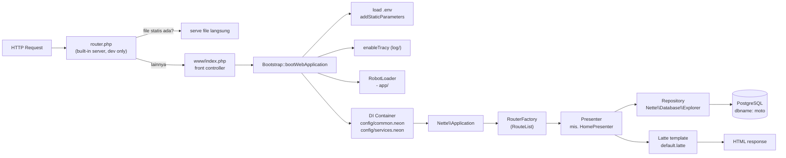

# Arsitektur aplikasi — motoDB

> **English abstract.** motoDB is a standard Nette 3.3 web application. The request lifecycle runs
> from the front controller (`www/index.php`) through `Bootstrap` (env loading, Tracy, RobotLoader,
> DI container), the router (`RouterFactory`), a presenter, its repositories (backed by
> `Nette\Database\Explorer`), and finally a Latte template. Repositories are auto-wired by their
> `*Repository` class suffix and always return plain `array`s so templates never depend on database
> internals.

## Alur request



Versi ASCII:

```text
HTTP Request
   │
   ▼
router.php (dev) ── file statis? ──► serve file langsung
   │ (lainnya)
   ▼
www/index.php ──► Bootstrap ──► load .env
                        ├─► enableTracy (log/)
                        ├─► RobotLoader (app/)
                        └─► DI Container
                               │
                               ▼
                     nette RouterFactory (RouteList)
                               │
                               ▼
                           Presenter
                             │
                    ┌────────┴────────┐
                    ▼                 ▼
              Repository        Latte template
        (Explorer/PDO)              │
                    │               │
                    ▼               │
               PostgreSQL           │
                    └───────┬───────┘
                            ▼
                      HTML response
```

## Lapisan aplikasi

1. **Front controller** — `www/index.php` mengautoload Composer, mem-boot container, dan menjalankan
   `Nette\Application\Application`.
2. **Bootstrap** — `app/Bootstrap.php`:
   - `loadEnv()` membaca `.env` via `parse_ini_file` dan memasukkannya sebagai parameter statis
     (`addStaticParameters`), sehingga `%DB_DSN%` dsb. bisa dipakai di NEON.
   - `initializeEnvironment()` menyalakan Tracy (log ke `log/`) dan mendaftarkan RobotLoader untuk
     folder `app/`.
   - `setupContainer()` memuat `config/common.neon` dan `config/services.neon`.
3. **Router** — `App\Core\RouterFactory::createRouter()` menghasilkan `RouteList` (lihat
   [rute-dan-halaman.md](rute-dan-halaman.md)).
4. **Presenter** — satu kelas per halaman di `app/Presentation/<Nama>/<Nama>Presenter.php`, dipetakan
   oleh `application.mapping: App\Presentation\*\**Presenter` di `common.neon`. Mengisi `$this->template`
   lalu me-render template Latte.
5. **Repository** — kelas di `app/Core/` yang membungkus akses data. Semuanya menginjeksi
   `Nette\Database\Explorer` dan **mengembalikan `array` polos** (via `Row::toArray()`) supaya template
   tidak bergantung pada bentuk objek database.
6. **Template** — file `.latte` memakai layout bersama `app/Presentation/@layout.latte`.
7. **Database** — PostgreSQL; skema dijaga oleh Phinx (`db/migrations`, `db/seeds`).

## Dependency injection & autowiring

`config/services.neon`:

```neon
services:
	- App\Core\RouterFactory::createRouter

search:
	-	in: %appDir%
		classes:
			- *Facade
			- *Factory
			- *Repository
			- *Service
```

- Service router didaftarkan secara eksplisit.
- Semua kelas di `app/` dengan akhiran `Facade`, `Factory`, `Repository`, atau `Service`
  **ditemukan otomatis** (DI scan) dan dapat di-inject tanpa deklarasi.
- `Nette\Database\Explorer` ikut terdaftar otomatis oleh ekstensi database di `common.neon`, jadi
  repository cukup menuliskannya di constructor.

Contoh wiring implisit:

```php
final class HomePresenter extends Nette\Application\UI\Presenter
{
	public function __construct(
		private readonly CatalogRepository $catalogs,     // autowire
		private readonly AccessoryRepository $accessories, // autowire
	) {
		parent::__construct();
	}
}
```

## Konfigurasi utama (`config/common.neon`)

```neon
application:
	errorPresenter:
		4xx: Error:Error4xx
		5xx: Error:Error5xx
	mapping: App\Presentation\*\**Presenter

database:
	dsn: %DB_DSN%
	user: %DB_USER%
	password: %DB_PASSWORD%

latte:
	strictParsing: yes
	extensions:
		- App\Presentation\Accessory\LatteExtension

di:
	export:
		parameters: no
		tags: no
```

| Kunci | Makna |
|---|---|
| `application.errorPresenter` | Presenter untuk halaman 4xx dan 5xx |
| `application.mapping` | Cara nama presenter dipetakan ke kelas di `app/Presentation/` |
| `database` | Koneksi Nette Database, diambil dari parameter `.env` |
| `latte.strictParsing` | `yes` → variabel/varian yang tidak dikenal memicu error pada saat kompilasi |
| `latte.extensions` | Ekstensi Latte terdaftar (saat ini `LatteExtension` masih placeholder kosong) |
| `di.export` | Parameter/tag DI tidak ikut diekspor ke autoload ekstra (mempercepat) |

## Ekosistem koneksi database

- **App runtime**: `Nette\Database\Explorer` memakai `DB_DSN`, `DB_USER`, `DB_PASSWORD` dari `.env`.
- **Phinx CLI**: `phinx.php` membaca `DB_HOST`, `DB_PORT`, `DB_NAME`, `DB_USER`, `DB_PASSWORD` dari
  `.env` yang sama — satu sumber kredensial untuk dua alat.

## Catatan desain

- Repository mengembalikan **array**, bukan `ActiveRow`, sehingga presenter/template tetap berfungsi
  bahkan jika implementasi penyimpanan diubah (mis. cache atau API).
- `LatteExtension` di `app/Presentation/Accessory/LatteExtension.php` terdaftar di
  `latte.extensions` tetapi masih kosong — tempat yang disiapkan untuk filter/fungsi Latte kustom.
- Router punya rute *fallback* `/<presenter>/<action>[/<id>]`, jadi URL Nette klasik tetap valid
  selain rute cantik `catalog`, `catalog/<id>`, `brand`, `brand/<id>`.