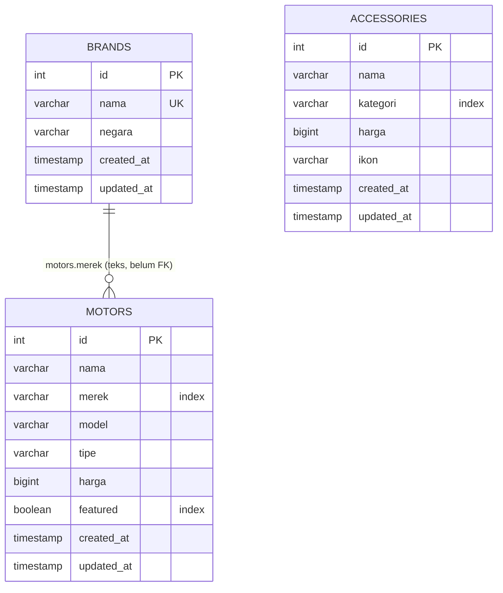

# Database — motoDB

> **English abstract.** motoDB uses a PostgreSQL database named `moto` with three application tables
> (`brands`, `motors`, `accessories`) plus `phinxlog`, which Phinx manages automatically. The schema
> is versioned with Phinx migrations under `db/migrations` and filled by idempotent seeders in
> `db/seeds`. There is currently no foreign key between `motors` and `brands` — the brand is stored
> as the text column `motors.merek`.

## ERD



Versi ASCII:

```text
+-----------------+      +------------------+      +-----------------+
|     brands      |      |     motors       |      |   accessories   |
+-----------------+      +------------------+      +-----------------+
| id      PK int  |      | id       PK int  |      | id       PK int  |
| nama    varchar |<<----| nama     varchar |      | nama     varchar |
|        (unique) | utk.  | merek    varchar |      | kategori varchar |
| negara  varchar | masa  |        (index)  |      |          (index) |
| created_at      | depan | model    varchar |      | harga    bigint  |
| updated_at      |      | tipe     varchar |      | ikon     varchar |
+-----------------+      | harga    bigint  |      | created_at       |
                         | featured boolean |      | updated_at       |
                         |        (index)  |      +-----------------+
                         | created_at      |
                         | updated_at      |
                         +------------------+

+-------------------------------+
| phinxlog (dikelola Phinx)     |
| version, start_time, end_time |
+-------------------------------+
```

## Skema tabel

### `motors`

| Kolom | Tipe | Null | Default | Keterangan |
|---|---|---|---|---|
| `id` | `serial` PK | no | identity | dibuat otomatis oleh Phinx |
| `nama` | `varchar(120)` | ya | — | nama lengkap, mis. "Honda Vario 160" |
| `merek` | `varchar(60)` | ya | — | brand sebagai teks (index) |
| `model` | `varchar(80)` | ya | — | mis. "Vario 160", dipakai di hero |
| `tipe` | `varchar(60)` | ya | — | mis. "Skuter", "Sport Naked" |
| `harga` | `bigint` | ya | — | harga OTR dalam Rupiah (int) |
| `featured` | `boolean` | no | `false` | penanda motor unggulan hero (index) |
| `created_at` | `timestamp` | no | `CURRENT_TIMESTAMP` | dari `addTimestamps()` |
| `updated_at` | `timestamp` | ya | — | dari `addTimestamps()` |

Index: `motors_pkey` (PK), `motors_merek_index`, `motors_featured_index`.

### `brands`

| Kolom | Tipe | Null | Default | Keterangan |
|---|---|---|---|---|
| `id` | `serial` PK | no | identity | |
| `nama` | `varchar(60)` | ya | — | **unique** → `brands_nama_unique` |
| `negara` | `varchar(60)` | ya | — | boleh kosong ("—" di UI) |
| `created_at` | `timestamp` | no | `CURRENT_TIMESTAMP` | |
| `updated_at` | `timestamp` | ya | — | |

### `accessories`

| Kolom | Tipe | Null | Default | Keterangan |
|---|---|---|---|---|
| `id` | `serial` PK | no | identity | |
| `nama` | `varchar(120)` | ya | — | |
| `kategori` | `varchar(60)` | ya | — | index `accessories_kategori_index` |
| `harga` | `bigint` | ya | — | |
| `ikon` | `varchar(30)` | ya | — | kunci ikon: `ban`, `velg`, `knalpot`, `rem` |
| `created_at` | `timestamp` | no | `CURRENT_TIMESTAMP` | |
| `updated_at` | `timestamp` | ya | — | |

### `phinxlog`

Dibuat otomatis oleh Phinx saat migration pertama dijalankan. Menyimpan versi migration yang sudah
diterapkan (`version`, `migration_name`, `start_time`, `end_time`, `breakpoint`). Tabel `phinxlog`
adalah konfigurasi `default_migration_table` di `phinx.php`.

## Migration

File ada di `db/migrations/`, memakai pola `YYYYMMDDHHMMSS_nama.php`:

| File | Tabel yang dibuat |
|---|---|
| `20261017090000_create_brands_table.php` | `brands` |
| `20261017090100_create_motors_table.php` | `motors` |
| `20261017090200_create_accessories_table.php` | `accessories` |

Semua memakai `change()`, jadi **reversibel otomatis** (`create()` → dibalik jadi `drop()` saat
rollback). Contoh pola:

```php
final class CreateMotorsTable extends AbstractMigration
{
	public function change(): void
	{
		$this->table('motors')
			->addColumn('nama', 'string', ['limit' => 120])
			->addColumn('harga', 'biginteger')
			->addColumn('featured', 'boolean', ['default' => false])
			->addIndex(['merek'], ['name' => 'motors_merek_index'])
			->addTimestamps()
			->create();
	}
}
```

### Membuat migration baru

```bash
vendor/bin/phinx create TambahKolomWarna
# → db/migrations/<timestamp>_tambah_kolom_warna.php
```

Isi metode `change()` (untuk yang reversibel) atau `up()`/`down()` (untuk yang tidak reversibel),
lalu jalankan `composer migrate`.

## Seeder

File ada di `db/seeds/`:

| Seeder | Isi |
|---|---|
| `BrandSeeder.php` | Honda (Jepang), Yamaha (Jepang), Kawasaki (Jepang) |
| `MotorSeeder.php` | Honda Vario 160 (Skuter, 27.000.000), Yamaha NMAX (Skuter Sport, 32.000.000), Kawasaki Ninja 250 (Sport Naked, 65.000.000, `featured = true`) |
| `AccessorySeeder.php` | Ban Tubeless (385.000), Velg Racing (1.250.000), Knalpot Racing (950.000), Cakram Rem (420.000) |

Setiap seeder **idempoten**: diawali pengecekan `COUNT(*)`; jika tabel sudah terisi, seeder berhenti.
Sehingga `composer seed` aman dijalankan berulang kali.

## Konfigurasi Phinx (`phinx.php`)

`phinx.php` membaca `.env` dan menyalurkannya ke environment `development`:

```php
$env = parse_ini_file(__DIR__ . '/.env', false, INI_SCANNER_RAW) ?: [];

return [
	'paths' => ['migrations' => '%%PHINX_CONFIG_DIR%%/db/migrations',
	            'seeds'      => '%%PHINX_CONFIG_DIR%%/db/seeds'],
	'environments' => [
		'default_migration_table' => 'phinxlog',
		'default_environment'     => 'development',
		'development' => [
			'adapter' => 'pgsql',
			'host'    => $env['DB_HOST'] ?? '127.0.0.1',
			'port'    => (int) ($env['DB_PORT'] ?? 5432),
			'name'    => $env['DB_NAME'] ?? 'moto',
			'user'    => $env['DB_USER'] ?? 'moto',
			'pass'    => $env['DB_PASSWORD'] ?? '',
		],
	],
	'version_order' => 'creation',
];
```

Karena dikunci ke `development`, perintah Phinx menampilkan peringatan
"no environment specified, defaulting to: development" — itu normal.

## Perintah terkait database

| Perintah | Fungsi |
|---|---|
| `composer migrate` | Terapkan migration yang belum diterapkan |
| `composer migrate:status` | Tabel status up/down |
| `composer migrate:rollback` | Batalkan **satu** migration terakhir |
| `vendor/bin/phinx rollback -t 0` | Batalkan semua migration |
| `vendor/bin/phinx seed:run` / `composer seed` | Isi data awal |

Catatan: `phinx rollback` tanpa argumen membatalkan satu migration (bukan seluruh batch).

## Akses data dari aplikasi

Repository memakai `Nette\Database\Explorer` dan mengembalikan `array`:

```php
// app/Core/CatalogRepository.php
public function findAll(): array
{
	return array_map(
		static fn(Nette\Database\Row $row): array => $row->toArray(),
		$this->db->table('motors')->order('id')->fetchAll(),
	);
}

public function findFeatured(): ?array
{
	$row = $this->db->table('motors')->where('featured', true)->order('id')->fetch()
		?? $this->db->table('motors')->order('id')->fetch();
	return $row === null ? null : $row->toArray();
}
```

## Rencana normalisasi (roadmap)

Saat ini `motors.merek` adalah teks dan belum ada relasi `motors.brand_id → brands.id`. Normalisasi
ke foreign key adalah perubahan penyimpanan yang halus bagi aplikasi karena repository sudah
mengembalikan array. Langkah yang disarankan:

1. Migration baru: `motors.brand_id` (int nullable) + FK ke `brands.id` (index).
2. Backfill `brand_id` dari `merek`.
3. Ubah repository/query untuk menggabungkan data brand bila diinginkan (mis. daftar motor per brand
   di halaman Brand).